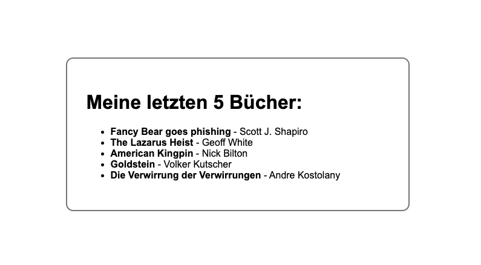

# Meine letzten 5 Bücher

Eine einfache Webseite, die die letzten 5 Bücher auflistet, die ich gelesen habe (09.2026 - 11.2026).

Zu jedem Buch gibt es einen Link mit weiterführenden Infos.

## Screenshot

### Sinn und Zweck des Projekts

Nach den Grundlagen von **Git**, erstelle ich hier ein kleines Übungs-Projekt.

- **Öffentlich** zur Kontrolle durch Dozenten
- **README.md** zur kurzen Erläuterung
- **Feature-Branches** damit das Hauptprojekt sicher bleibt
- **Sinnvolle Commit-Nachrichten** um Änderungen zu dokumentieren
- **.gitignore** um sensible Inhalte und ggf. Speicherplatz zu schonen
- **GitHub Issues** (zusätzlich, nicht gefordert): Aufgaben und Ideen
- **Tag** (zusätzlich, nicht gefordert): Version 1.0
- **GitHub Actions** Repository herunterladen, Ordner & Projektverzeichnis anzeigen, Begrüßung im Protokoll
